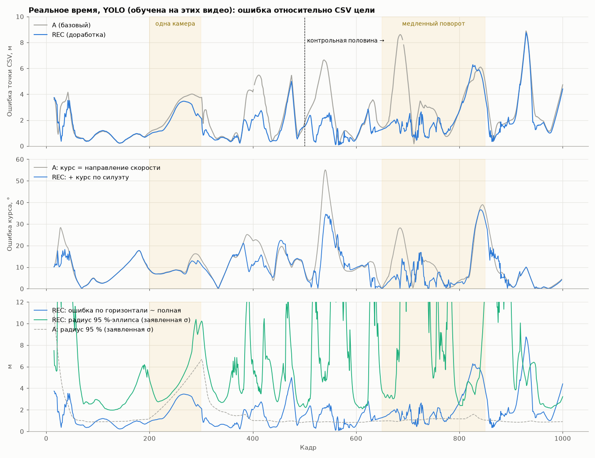

# Доработка точности 3D-трекинга: ориентация по изображению, дорога, неопределённость

Ветка `claude/lucid-davinci-vuf745`. Все цифры получены из запусков, указанных в каждом разделе.
Оговорки, обязательные для всех чисел на реальном видео:

- YOLO (`models/best.pt`) дообучена на этих же видео: детекции и маски оценены на обучающих данных.
- Независимого набора данных нет. Протокол: параметры выбирались **только по кадрам 0–499**, а кадры
  500–1000 — контрольные. Это одно и то же видео, так что это не оценка обобщения на новые сцены.
  Часть параметров сцены по-прежнему подобрана по CSV цели раньше (точка CSV на модели, масштаб,
  пределы ускорения, СКО ребра 20 px).
- CSV цели не используется трекером, только для оценки. Курса в CSV нет: «истинный курс» — направление
  скорости точки CSV (передний край кабины), сглаженное сплайном.
- Проверялись только записанные видео, готовые детекции и синтетика. На живых камерах не проверялось.

## 1. Итог

Рекомендуемая конфигурация **REC** = вариант A + курс по силуэту (O) + гомография (H) + дорожная плоскость (R)
+ подтверждение и проверка передачи (V) + модель неопределённости (U). Файл: `configs/upgrade_recommended.json`.
Значения по умолчанию в `pipeline/config.py` не менялись: без этого файла работает исходный вариант A.

Точка CSV цели, м (медиана / p95 / макс), реальное время, только прошлые кадры:

| вариант | всё видео (984 кадра) | подбор 0–499 | **контроль 500–1000** | курс, медиана / p95, ° | тик p50 / p95, мс |
|---|---|---|---|---|---|
| A (базовый, контроль) | 1.98 / 6.10 / 8.89 | 1.19 / 4.44 / 5.48 | 2.57 / 7.26 / 8.89 | 9.1 / 30.3 | 0.9 / 1.1 |
| **REC** | **1.36 / 4.83 / 8.76** | **1.05 / 3.43 / 5.00** | **1.64 / 5.89 / 8.76** | **8.1 / 24.6** | 4.3 / 7.9 |
| ALL (REC + дальность M) | 1.34 / 4.83 / 8.82 | 1.06 / 3.41 / 5.00 | 1.63 / 5.88 / 8.82 | 8.2 / 24.6 | 4.2 / 7.5 |

Базовый результат перед работой был перезапущен: `python -m pipeline.variants --variants A` →
1.98 / 6.10 / 8.89 м на 984 кадрах. В документах ветки было 1.99 / 6.12 / 8.96 — тот же режим (рёбра,
все камеры, без триангуляции и сплайна) и те же кадры; отличие ~1 см, его причина не выяснялась (документы
могли быть записаны до последних коммитов ветки). Новые возможности по умолчанию выключены, и вариант A
после доработки даёт ровно те же 1.98 / 6.10 / 8.89.

Главное, что выяснилось. Основная ошибка — **поперечная**, и её источник — **курс**. Точка CSV стоит на
переднем краю кабины, ~11 м от центра модели, поэтому ошибка курса 9° сдвигает её на ~1.7 м. Курс по
скорости центра на поворотах отстаёт и смещается (−11° на кадрах 300–500, −16° на 500–650). Курс по
силуэту — главный вклад: без него REC на контрольной половине 2.34 / 7.12 м вместо 1.64 / 5.89.

Время: курс по силуэту стоит ~3–4 мс на тик (сопоставление 36 + 22 курсов на камеру). Тик REC p95 7.9 мс
при бюджете 33 мс на кадр (30 FPS). Это режим detections, без стоимости YOLO.



## 2. Изменённые и новые файлы

| файл | что |
|---|---|
| `reconstruction/ground.py` (новый) | дорожная плоскость, гомография дорога ↔ изображение, онлайн-модель дороги |
| `reconstruction/orientation.py` (новый) | курс по изображению: моменты маски, сопоставление силуэта модели, объединение камер |
| `reconstruction/visibility.py` | трекер: дисперсия курса, курс по силуэту, вспомогательные измерения (дорога, гомография, дальность), строгая инициализация, проверка передачи между камерами, коррекция ковариации после пределов, рост неопределённости без стерео, ковариация точки вывода, уровни наблюдения |
| `pipeline/config.py` | разделы `orientation`, `road`, `homography`, `mono_depth`, `confirmation`, `uncertainty` |
| `pipeline/streaming.py` | передача параметров, контуры масок в трекер (`load_polygons`), новые поля записи и CSV трека |
| `pipeline/variants.py` | варианты A+O/H/R/M/V/U, ALL, REC; метрики глубины, курса, калибровки, NIS, участков |
| `pipeline/scenarios.py` (новый) | 13 синтетических сценариев и отчёт |
| `configs/upgrade_recommended.json` (новый) | рекомендуемая конфигурация (REC) |
| `tests/test_ground.py`, `tests/test_orientation.py`, `tests/test_upgrade_tracker.py` (новые) | 31 тест |
| `docs/UPGRADE_REPORT.md`, `docs/results/upgrade/` | этот отчёт, таблицы и графики |

## 3. Соглашения (проверены перед изменениями)

- Мир — Unreal Engine: левая система, Z вверх, сантиметры (`units_per_meter = 100`).
- Камера: `R` — мир → камера, строки — оси (right, −up, forward), пиксель `p ~ K R (X − C)`.
- **Состояние фильтра — центр габаритного параллелепипеда 3D-модели** (не центр кузова и не центр кабины).
  Основание модели — центр − H/2 по вертикали (нижние вершины модели — колёса). Точка CSV цели —
  передний край кабины, 3 м над дорогой (`TruckModel.csv_point`). Центр кабины — `TruckModel.cab_center`.
  Центроид маски — точка изображения, не 3D-точка: его в дорожную гомографию не подставляем.
- Смысл существующих координат не менялся. Точка контакта с дорогой — отдельная величина:
  центр − (H/2)·нормаль дороги.

## 4. Курс по изображению (`reconstruction/orientation.py`)

1. **Главная ось маски** (`mask_axis`): PCA по моментам площади контура (формулы Грина) даёт угол
   (mod 180°) и вытянутость. Ось в изображении не равна курсу в 3D (она зависит от ракурса), поэтому
   в трекер напрямую не идёт. Используется в тестах и для диагностики.
2. **Сопоставление силуэта** (`SilhouetteMatcher`): для курса θ выпуклая оболочка 3D-модели (101 вершина;
   без FBX — углы коробки) при прогнозном центре и продольном уклоне трека проецируется в камеру.
   Проекция совмещается с маской по центроиду площади: ошибка положения центра почти не сдвигает
   курс (тест: 2 м ошибки центра → < 6°). Затем IoU выпуклых оболочек считается на растре 64×64.
   Сетка — 36 курсов через 10°, плюс уточнение ±10° через 2° вокруг лучшего направления и противоположного.
3. **Согласование камер**: S(θ) = Σ w_c · IoU_c(θ), w_c — уверенность детектора. Камера не участвует, если:
   - рамка касается края кадра;
   - у рамки есть закрытое ребро (трекер находит его до сопоставления — см. ниже);
   - рамка отброшена гейтом;
   - маска мала;
   - лучшее совпадение маски с моделью IoU < 0.55 (испорченная маска или чужой объект).
4. **Раздельная достоверность**:
   - ось: контраст сложенной кривой max − min, на камеру; меньше 0.04 — измерения нет;
   - перед/зад: S(θ*) − S(θ* + 180°), на камеру; меньше 0.03 — выдаётся только ось (`axis_only`),
     и трекер выбирает из двух направлений ближайшее к своему курсу, а не «придумывает» перед;
   - СКО: полуширина пика на уровне peak − 0.02 (на камеру), не меньше 4°.
5. **Объединение в трекере** (`CabTracker._visual_heading_update`) — скалярный фильтр по курсу:
   - дисперсия курса трека — информация направления скорости (поперечная дисперсия скорости / v²),
     плюс случайное блуждание, плюс систематика: нижняя граница 5° и «скорость поворота × 1 с»
     (курс по скорости отстаёт на повороте);
   - дисперсия измерения — σ² пика + (15°)² (несовпадение модели и маски, склон, тень в маске);
   - вес измерения = дисперсия трека / (дисперсия трека + дисперсия измерения);
   - невязка больше 3√S — измерение отклоняется; поправка за кадр не больше 5°;
   - на скорости ≥ 3 м/с визуальный курс дальше 35° от направления скорости не принимается: кузов не
     едет боком. Без этого правила ошибка «перед/зад» на контрольной половине разворачивала модель
     (p95 25 м).
   - Курс исправляется **до** обновления по рёбрам, так что рамка проекции модели считается уже с ним.

Проверка на реальных масках с истинным центром (`orient_check`, только для диагностики): медианная ошибка
оси 11°, p90 42°. Хуже всего при частичном перекрытии деревьями (cam4 на кадре 770, cam3 на кадре 680:
маска покрывает только видимую часть) и на склоне (cam5 на кадре 830: модель считается горизонтальной).
Поэтому измерение подаётся с консервативной СКО, а камеры с закрытыми рёбрами исключаются.
Отдельная обучаемая модель перед/зад не добавлялась: размеченной выборки ориентации нет.

## 5. Гомография и дорожная плоскость (`reconstruction/ground.py`)

- **Формула.** Точка плоскости X = X0 + a·e1 + b·e2, тогда R (X − C) = a·R e1 + b·R e2 + R (X0 − C),
  и **H = K [R e1 | R e2 | R (X0 − C)]**, p ~ H (a, b, 1). Формула совпадает с общей для R «мир → камера».
  Проверена тестом против `Camera.project` (три камеры, одна с креном 7°, наклонная плоскость).
- **Обратное преобразование** через H⁻¹. Недопустимы:
  - пиксель выше горизонта: точка пересечения не перед камерой;
  - точка дальше рабочей области `max_range_m`;
  - вырожденная H: камера в плоскости, число обусловленности больше порога.
- **Ковариация** — аналитический якобиан ∂X/∂(u, v).
- **Плоскость дороги.** `RoadPlane` — точка и нормаль; `fixed` — заданная высота.
  `OnlineRoadModel` — кусочно-плоская модель, оцениваемая причинно по точкам контакта самого трека
  на кадрах с ≥ 2 камерами:
  - локальная плоскость z = a + b·x + c·y в радиусе 30 м, взвешенно;
  - уклон оценивается, только если точки разнесены;
  - СКО по MAD невязок, растёт при экстраполяции;
  - буфер ограничен 2000 точками. CSV цели не используется.
- **Точка основания для гомографии**: середина низа рамки детектора + поправка ракурса. Поправка —
  разность проекции основания модели под центром и середины низа прогнозной рамки, по прогнозу.
  Центроид маски не используется: он над дорогой.
- **В трекере** — слабые измерения, только когда нет стерео (`only_without_stereo`), каждое с гейтом NIS:
  - `road`: z центра = z дороги + H/2; СКО — СКО плоскости, не меньше 0.3 м;
  - `homography:N`: (x, y) центра по точке основания камеры N. Ковариация = J Σ_px Jᵀ ·2 (коррелирована
    с рёбрами той же камеры) + неопределённость высоты дороги вдоль луча + рычаг курса.
- Гомография не заменяет триангуляцию и рёбра: при стерео она не используется. Включать её «всегда»
  хуже: на контрольной половине 3.32 / 9.57 м против 2.60 / 7.27 м.

## 6. Дальность по известным габаритам (`monocular_range`)

Прогнозная рамка — проекция самой 3D-модели при прогнозном центре и курсе. Поэтому ориентация и
перспектива уже учтены, а не заложены в формулу «H / h». Дальность: r_изм = r_пр · (w_пр + h_пр) / (w + h).

Не используется, если рамка мала, если какое-то ребро закрыто или в краю кадра, или если ширина и
высота дают разную дальность больше 15 % (обрезка, перекрытие, неверный курс).

СКО: 8 % (несовпадение модели и силуэта) ⊕ пиксельный шум ⊕ чувствительность размера к курсу × СКО курса.
Конфликт с гомографией той же камеры (дальности расходятся больше 3σ): остаётся то измерение, которое
лучше согласуется с прогнозом. Усреднения нет.

**Результат: в рекомендуемую конфигурацию не включена.**
- На реальном видео нейтральна: контрольная половина 2.57 / 7.26 м, как у A.
- В сценарии потери стерео немного ухудшает: REC 3.89 м против ALL 4.19 м (p95). Без проверки формы
  в первой версии она «тормозила» грузовик на кадрах 280–296: p95 участка с одной камерой 11.9 м.
- Причина в избыточности: размер рамки уже входит в измерение по рёбрам той же камеры, так что
  отдельная дальность — то же самое измерение второй раз, с систематикой модели.

## 7. Передача между камерами и подтверждение

- Состояние одно, в мировой системе. Новый трек при смене камер не создаётся: во всех сценариях
  1 инициализация, у A при потере стерео было 2.
- `CabTracker.expected_view(camera)`: ожидаемая рамка проекции модели, центр рамки и его ковариация
  J P Jᵀ, видна ли рамка, ожидаемый курс и его СКО.
- **Проверка камеры, снова увидевшей грузовик** (`handoff_gate_chi2 = 13.8`): пока её детекция не
  согласовалась с прогнозом хоть раз, центр рамки проверяется по χ² с ковариацией
  J P Jᵀ + (σ_ребра² + (0.15·размер)²). Как и старый гейт, она не отклоняет большинство детекций тика:
  если с прогнозом не согласны почти все, неправ прогноз. В сценарии «чужой объект при появлении»
  отклонены все 25 рамок соседнего объекта: p95 5.83 → 0.54 м.
- **Строгая инициализация**:
  - инлаеры триангуляции из ≥ 2 разных камер;
  - максимальный угол лучей ≥ 10°;
  - невязка ≤ 40 px;
  - точка перед камерами.
  Две почти соосные камеры трек не стартуют (тест). Подтверждение (≥ 2 камер) и сопровождение
  разделены, как и раньше: `_confirmed`, гейт рамок, переинициализация по стерео.
- На реальном видео ложных детекций и ложных инициализаций нет, поэтому V там ничего не меняет.

## 8. Модель неопределённости

| источник | как учтён | параметр |
|---|---|---|
| ковариация фильтра | P, как раньше; после каждого шага симметрия и PSD | — |
| физические пределы (обрезка скорости и сдвига) | **P ← P + δδᵀ**, δ — внесённая поправка; P не может остаться как без поправки (тест: P_clip ⪰ P) | `uncertainty.clip_covariance` |
| нет стерео | процессный шум × (1 + 0.5·с без стерео), не больше ×10; СКО вдоль луча единственной камеры растёт на 1 м/с | `no_stereo_q_growth_per_s`, `depth_sigma_growth_mps` |
| детектор, маска | СКО ребра / √(уверенность · вес после появления), Хьюбер, как раньше | `tracker.edge_sigma_px` |
| несовпадение модели с силуэтом, калибровка камеры | в квадратуре к СКО ребра, не масштабируется уверенностью (систематика) | `model_sigma_px = 5`, `calibration_sigma_px` |
| курс | дисперсия курса (скорость + блуждание + нижняя граница + запаздывание на повороте); в ковариацию точки вывода через рычаг; в рёбра — опционально (`heading_in_edges` ухудшает: выключено) | `heading_sigma_floor_deg`, `heading_turn_lag_s` |
| погрешность длины модели | (σ_L/2)² вдоль оси в ковариацию точки вывода | `model_length_sigma_m = 0.6` |
| дорога и гомография | СКО плоскости (MAD, экстраполяция) вдоль луча; пиксельная ошибка через якобиан H⁻¹ | `road.sigma_m`, `homography.sigma_px` |

Уровни наблюдения в каждом кадре (`observation_level`):
- `multi` — ≥ 2 камер, рёбра не закрыты;
- `multi_partial` — ≥ 2 камер, есть закрытые или отброшенные;
- `single` — одна камера;
- `road` — только вспомогательные измерения;
- `predicted` — только прогноз;
- `lost` — прогноз дольше 90 кадров;
- `initializing` — трек ещё не начат.

Пишутся в CSV трека вместе с `frames_since_stereo`, СКО точки вывода и курса, используемыми
вспомогательными измерениями. Прогноз помечается прогнозом, а не измерением.

**Калибровка** (горизонталь, точка CSV, всё видео):

| | σ, медиана, м | \|e\|/σ, медиана / p95 | в 1σ (идеал 39 %) | в 95 %-эллипсе (идеал 95 %) |
|---|---|---|---|---|
| A | 0.41 | 2.08 / 11.04 | 7 % | 40 % |
| REC | 2.08 | 0.36 / 1.62 | 47 % | 83 % |

СКО базового варианта занижена в разы: он считает курс по скорости точным до ±1°. REC ближе к
заявленному уровню, но идеально не откалиброван:
- на повороте СКО завышена (член «запаздывание × скорость поворота»);
- на разгоне до 31 м/с (кадры 900–940) и на кадрах 820–840 занижена: там продольная ошибка не
  моделируется.

В синтетике, где систематики почти нет, СКО REC завышена: |e|/σ ≈ 0.05–0.1. Систематические члены —
параметры сцены. Проверка: `extended_metrics` в `pipeline/variants.py`, где есть NIS точки и
вспомогательных измерений и доля отклонённых.

## 9. Ablation на реальном видео

Источники: `docs/results/upgrade/real_full.md`, `real_tune_0_499.md`, `real_test_500_1000.md`.

| вариант | подбор 0–499 | контроль 500–1000 | что показывает |
|---|---|---|---|
| A | 1.19 / 4.44 / 5.48 | 2.57 / 7.26 / 8.89 | контроль |
| A+O курс по силуэту | 1.12 / 3.69 / 4.96 | 1.87 / 5.89 / 8.94 | главный вклад |
| A+H гомография | 1.19 / 4.44 / 5.48 | 2.60 / 7.27 / 8.88 | нейтрально (без стерео почти не бывает) |
| A+R дорога | 1.20 / 4.45 / 5.49 | 2.56 / 7.23 / 8.83 | нейтрально; участок с одной камерой 3.09 → 2.77 м (медиана) |
| A+M дальность | 1.21 / 4.44 / 5.48 | 2.57 / 7.26 / 8.89 | нейтрально |
| A+V подтверждение | 1.19 / 4.44 / 5.48 | 2.57 / 7.26 / 8.89 | нет ложных детекций — без изменений |
| A+U неопределённость | 1.12 / 4.48 / 5.52 | 2.35 / 7.20 / 8.89 | калибровка 40 % → 72 % в 95 % |
| ALL | 1.06 / 3.41 / 5.00 | 1.63 / 5.88 / 8.82 | |
| REC | 1.05 / 3.43 / 5.00 | 1.64 / 5.89 / 8.76 | рекомендуемая |

Если убрать компонент из ALL, контроль 500–1000 даёт:
- без O: 2.34 / 7.12;
- без U: 1.82 / 5.91;
- без R: 1.77 / 6.25;
- без H: 1.69 / 5.61;
- без M: 1.64 / 5.89;
- без V: без изменений.

**Чувствительность курса по силуэту** (контроль 500–1000; все варианты с нижней границей курса трека
5° и запаздыванием 1 с):
- исходные значения, выбранные до подбора (σ-пол 15°, увод 35°): 1.87 / 5.89 / 8.94;
- σ-пол 8°: 2.23 / 7.25;
- σ-пол 8°, увод 20°: 1.76 / 6.30;
- σ-пол 5°, увод 25° — лучший на подборочной половине (0.94 / 3.15): на контроле 2.56 / 7.36.

Настройка, лучшая на подборочной половине, на контроле не лучше. Поэтому оставлены исходные значения,
а эффект курса по силуэту надо считать чувствительным к параметрам.

**Где стало лучше** (REC против A, всё видео; больше чем на 1 м — на 241 кадре):
- кадры 387–428: 4.2–4.6 → 1.7–2.1 м;
- кадры 515–560: 4.7 → 1.5 м;
- медленный поворот 668–744: 6.9 → 1.7 м;
- участок с одной камерой 200–300: медиана 3.09 → 2.34 м.

**Где хуже** (больше чем на 1 м — 4 кадра):
- кадры 19–24, сразу после инициализации: 1.7 → 2.6 м;
- кадры 822–830, выход из поворота: 5.2 → 6.0 м.

**Что не исправлено.** Максимум 8.8 м на кадрах 928–933: разгон до 31 м/с, ошибка продольная
(отставание при пределе ускорения 12 м/с²). Доработки её не трогают.

## 10. Синтетические сценарии (`python stream.py upgrade-scenarios`)

Коробка 16.5 × 2.55 × 4 м, 4 камеры, шум рамки 1.5 px; истина — из генератора. Полная таблица по всем
вариантам: `docs/results/upgrade/scenarios.md`. Ошибка низа передней грани, м (медиана / p95 / макс):

| сценарий | A | REC | замечание |
|---|---|---|---|
| прямо | 0.07 / 0.15 / 0.37 | 0.06 / 0.13 / 0.33 | |
| медленный поворот (2 м/с, 60° за 8 с) | 7.79 / 15.89 / 16.72 | 0.18 / 0.34 / 0.50 | курс A 48°, REC 0.9° |
| резкий поворот (90° за 2 с) | 0.12 / 8.79 / 9.79 | 0.07 / 0.84 / 1.47 | |
| частичное перекрытие | 0.19 / 0.50 / 0.68 | 0.28 / 0.55 / 0.69 | **хуже** по медиане |
| нет двух камер 100 кадров | 0.12 / 0.62 / 0.75 | 0.10 / 0.75 / 0.87 | **хуже** по p95 |
| потеря стерео (одна камера 4 с) | 0.14 / 43.54 / 49.27 | 0.11 / 3.89 / 10.16 | A разворачивается и переинициализируется |
| потеря всех камер 1 с и восстановление | 0.12 / 3.90 / 4.53 | 0.08 / 3.08 / 4.80 | скачок при возврате 1.2–1.3 м у обоих |
| ложные детекции (10 % + серия 15 кадров) | 0.11 / 1.09 / 1.60 | 0.12 / 0.69 / 1.16 | |
| чужой объект при появлении камеры | 0.14 / 5.83 / 8.90 | 0.10 / 0.54 / 0.60 | |
| ошибки маски (25 %) | 0.38 / 4.73 / 6.04 | 0.22 / 0.62 / 1.00 | |
| смещение рамки 10–15 px | 0.21 / 0.40 / 0.56 | 0.26 / 0.48 / 0.57 | **хуже** |
| неверная ориентация маски (40°, одна камера) | 0.40 / 4.67 / 6.13 | 0.26 / 0.64 / 0.86 | |
| несовпадение модели (+12 % длина, +10 % высота) | 1.00 / 2.20 / 2.80 | 1.09 / 1.30 / 1.35 | систематика ~1 м остаётся у обоих |

Ухудшения на перекрытии, отсутствии двух камер и смещении рамки — 5–13 см. Вероятная причина —
`model_sigma_px = 5` при шуме синтетики 1.5 px: рёбра получают меньший вес, чем заслуживают.
Систематические члены — параметры сцены, и для реального видео они уместнее, чем для синтетики.

## 11. Тесты

`.venv/bin/pytest -q` → **150 passed** (было 119, добавлен 31, существующие не удалялись и не менялись).

| тема | тесты | что проверяется численно |
|---|---|---|
| гомография | `test_ground.py` (9) | прямое и обратное преобразование против `Camera.project` (< 1e-4); несколько камер и камера с креном; наклонная плоскость; вырожденная H; горизонт и рабочая область; якобиан против конечной разности; согласованность двух камер; онлайн-дорога: уклон, СКО, ограниченный буфер |
| ориентация | `test_orientation.py` (6) | моменты и ось повёрнутого прямоугольника; ось < 4° при неопределённости 180° для симметричной коробки; ошибка центра 2 м → < 6°; мусорная и крошечная маска не используются; противоречивая камера (40°) не перетягивает (< 10°) |
| дальность | `test_upgrade_tracker.py` | ±3 % при курсах 0°, 60°, 135°; закрытая, обрезанная и крошечная рамка → нет измерения |
| межкамерное | `test_upgrade_tracker.py` | чужой объект отклонён (≥ 20 рамок, p95 < 1 м против > 1 м у A); пропажа двух камер и полная потеря — одна инициализация, скачок < 2 м, прогноз помечен; ожидаемая проекция < 10 px от наблюдения |
| неопределённость | `test_upgrade_tracker.py` | без стерео СКО не убывает и растёт вдоль луча камеры (|cos| > 0.9); возврат СКО после стерео; P после обрезки ⪰ P без коррекции; симметрия и PSD всех ковариаций; члены курса (рычаг × 5°) и длины модели в ковариации точки вывода; строгая инициализация отклоняет соосные камеры |
| сценарии | `test_upgrade_tracker.py` | медленный поворот (курс < 3°), потеря стерео (p95 < 6 м, в 95 % > 85 %), перекрытие и неверная маска (курс p95 < 6°) |
| конфигурация | `test_upgrade_tracker.py` | по умолчанию всё выключено; рекомендуемый JSON загружается и совпадает с REC |

## 12. Параметры конфигурации

Все параметры в `pipeline/config.py`. В столбце «REC» — значения из рекомендуемого файла; прочерк
значит, что берётся значение по умолчанию.

| параметр | по умолчанию | REC | смысл |
|---|---|---|---|
| `orientation.enabled` | false | true | курс по силуэту |
| `orientation.sigma_floor_deg` | 15 | — | систематика силуэта |
| `orientation.gate` / `max_step_deg` | 3 / 5 | — | гейт невязки, шаг за кадр |
| `orientation.max_slip_deg` / `slip_speed_mps` | 35 / 3 | — | запрет увода от направления скорости |
| `orientation.min_iou` / `min_axis_contrast` / `min_front_margin` | 0.55 / 0.04 / 0.03 | — | пригодность маски, ось, перед/зад |
| `road.mode` | none | online | дорожная плоскость |
| `road.constraint` / `only_without_stereo` | false / true | true / — | основание на дороге |
| `road.sigma_m` / `radius_m` / `min_points` | 0.3 / 30 / 15 | — | |
| `homography.enabled` | false | true | точка основания → (x, y) |
| `homography.sigma_px` / `inflation` / `max_range_m` / `only_without_stereo` | 6 / 2 / 150 / true | — | |
| `mono_depth.enabled` | false | false | дальность по габаритам (не рекомендуется) |
| `mono_depth.rel_sigma` / `shape_tol` | 0.08 / 0.15 | — | |
| `confirmation.init_min_cameras` / `init_min_ray_angle_deg` / `init_max_reproj_px` | 2 / 0 / 0 | — / 10 / 40 | строгая инициализация (0 — без проверки) |
| `confirmation.handoff_gate_chi2` | 0 | 13.8 | проверка камеры после появления |
| `confirmation.aux_gate_chi2` | 9.21 | — | гейт вспомогательных измерений |
| `uncertainty.clip_covariance` | false | true | P + δδᵀ после пределов |
| `uncertainty.no_stereo_q_growth_per_s` / `no_stereo_q_max` | 0 / 10 | 0.5 / — | рост шума без стерео |
| `uncertainty.depth_sigma_growth_mps` | 0 | 1.0 | рост СКО вдоль луча |
| `uncertainty.model_sigma_px` / `calibration_sigma_px` | 0 / 0 | 5 / — | систематика модели и калибровки |
| `uncertainty.heading_sigma_floor_deg` / `heading_turn_lag_s` | 0 / 0 | 5 / 1.0 | систематика курса |
| `uncertainty.model_length_sigma_m` | 0 | 0.6 | погрешность длины модели |
| `uncertainty.heading_in_edges` | false | false | курс в рёбра (ухудшает) |
| `uncertainty.lost_after_frames` | 90 | — | уровень «потерян» |

Запуск:

```bash
.venv/bin/python -m pipeline.variants --variants A,REC --out outputs/upgrade/full
.venv/bin/python -m pipeline.variants --variants A,REC --test-frames 500:1000 --out outputs/upgrade/test_half
.venv/bin/python stream.py upgrade-scenarios --variants A,REC
# поток с REC по готовым детекциям (проверено: 1.36 / 4.83 / 8.76 м, как вариант REC)
.venv/bin/python stream.py detections --data tmp/project2 --detections outputs/main/detections \
    --config configs/upgrade_recommended.json --out outputs/upgrade/stream_rec
.venv/bin/python stream.py replay --config configs/upgrade_recommended.json --video   # видео + YOLO
```

## 13. После слияния с master: гистерезис и плавность траектории

В master есть гистерезис закрытых рёбер (`tracker.occlusion_hold_frames = 3`, `occlusion_ramp_frames = 8`):
решение «ребро закрыто» удерживается 3 кадра и снимается плавно. По умолчанию он включён (так работал
`main.py` в master). На трекере этой ветки он меняет точность и плавность в разные стороны (YOLO, точка CSV;
«ускорение» — вторая разность выходной траектории, p95):

| | гистерезис выкл. | гистерезис вкл. |
|---|---|---|
| A, всё видео | 1.98 / 6.10 / 8.89 м, ускорение 118 м/с² | 1.98 / 6.28 / 9.56 м, 72 м/с² |
| REC, всё видео | 1.36 / 4.83 / 8.76 м, 677 м/с² | 1.43 / 5.45 / 9.36 м, 745 м/с² |

Поэтому варианты A и REC в сравнении (`pipeline/variants.py`, `configs/upgrade_recommended.json`) идут без
гистерезиса, а `main.py` по умолчанию — с ним.

**Найденная после отчёта проблема REC — дрожание точки вывода.** Ускорение по выходной траектории у REC
p95 677 м/с² против 118 у A. Курс по силуэту поправляется до 5° за кадр, а точка CSV в ~11 м от центра модели:
каждая поправка двигает её почти на 1 м за кадр. Курс по скорости тянет курс обратно, получается зигзаг.
Средняя ошибка меньше, но траектория точки CSV неровная. Центр модели (состояние фильтра) этим не затронут.

Проверено (подбор 0–499 / контроль 500–1000; точка CSV, м; ускорение p95, м/с²):

| | подбор | контроль |
|---|---|---|
| REC (direct, шаг 5°) | 1.05 / 3.43 / 5.00, 274 | 1.64 / 5.89 / 8.76, 887 |
| direct, шаг 1° | 1.12 / 4.45 / 5.50, 172 | 2.24 / 7.10 / 8.77, 168 |
| `orientation.mode = bias`, шаг 1° | 0.85 / 2.69 / 4.22, 261 | 1.79 / 6.63 / 9.33, 295 |

`bias` — курс по силуэту оценивает увод кузова от направления скорости, а цель курса по скорости =
направление скорости + увод; они больше не перетягивают курс. Это лучший вариант на подборочной
половине и втрое плавнее на контроле, но на контроле менее точен, чем REC. Выбор между точностью и
плавностью не сделан: по умолчанию `direct` (как в REC), `bias` доступен опцией.

## 14. Что пробовали и отклонили

- **Точка поворота кузова.** Цель курса = направление скорости центра + atan2(d·ω, v): точка кузова,
  чья скорость направлена вдоль оси, впереди или позади центра. На подборочной половине хуже при любом
  d: −7, +5, +10.9, +15 м, медиана 2.3–6.8 м против 1.19. Скорость поворота берётся из самого курса,
  получается обратная связь. Код удалён.
- **Курс в ковариации рёбер.** Хуже на обеих половинах: подбор 1.46 м, контроль 2.99 м. Выключено.
- **Гомография и дорога «всегда», а не только без стерео.** Хуже на подборочной половине; гомография
  и на контрольной.
- **Курс по силуэту без запрета увода.** На контрольной половине разворот «перед/зад», p95 25 м.

## 15. Ограничения и что не сделано

- **Независимой проверки нет.** Подбор и контроль — половины одного видео. YOLO обучена на нём же.
- **Курс по силуэту чувствителен к параметрам** (раздел 9). Модель силуэта горизонтальна с продольным
  уклоном трека: поперечный крен на склоне не учитывается. Частично закрытую маску сопоставитель
  не отличает от вида спереди: защита — исключение камер с закрытыми рёбрами, и она зависит от того,
  поймала ли перекрытие проверка рёбер.
- **Перед/зад** у этой модели на реальных масках различается слабо: перевес обычно меньше порога,
  и курс берётся с точностью до оси (направление — от трека).
- **Калибровка неопределённости неполная:** 83 % в 95 %-эллипсе на реальном видео. На повороте СКО
  завышена, на разгоне занижена. Продольное отставание при разгоне в модели неопределённости не учтено.
- **Дорога online** строится из собственных оценок трека: систематическая ошибка высоты трека переходит
  в дорогу. Плоскость в сцене не задана: геометрии рельефа из Unreal нет.
- **Дальность по габаритам** реализована и проверена тестами, но в рекомендуемую конфигурацию не
  входит (раздел 6).
- Ложных детекций и ложных инициализаций на реальном видео нет: их обработка проверена только на синтетике.
- Обучаемая модель перед/зад и YOLO-pose не добавлялись: нет размеченной выборки.
- Многообъектный трекинг, живые камеры и инфраструктура под них не затрагивались.
