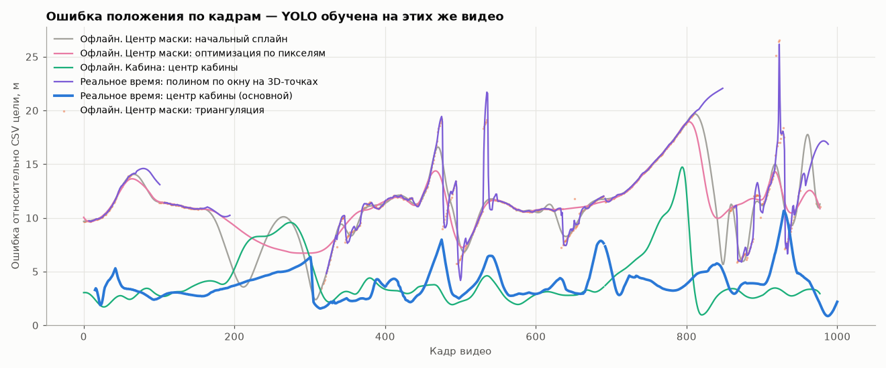
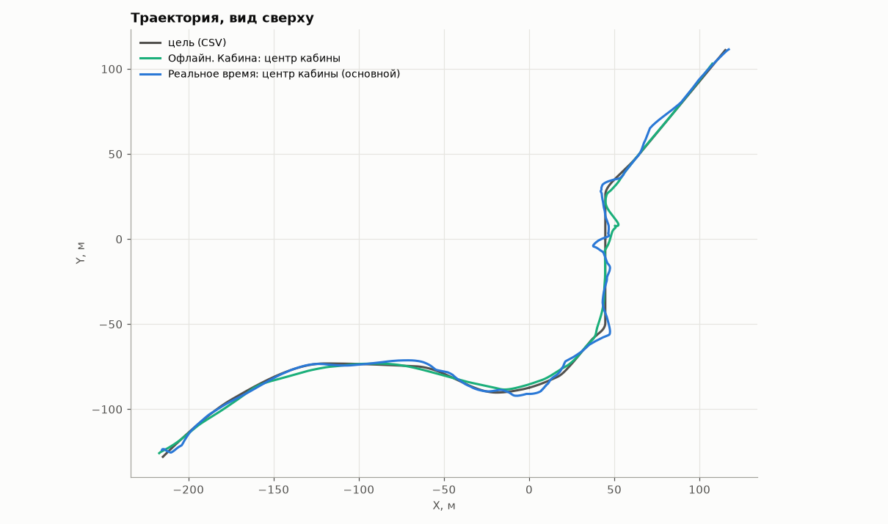
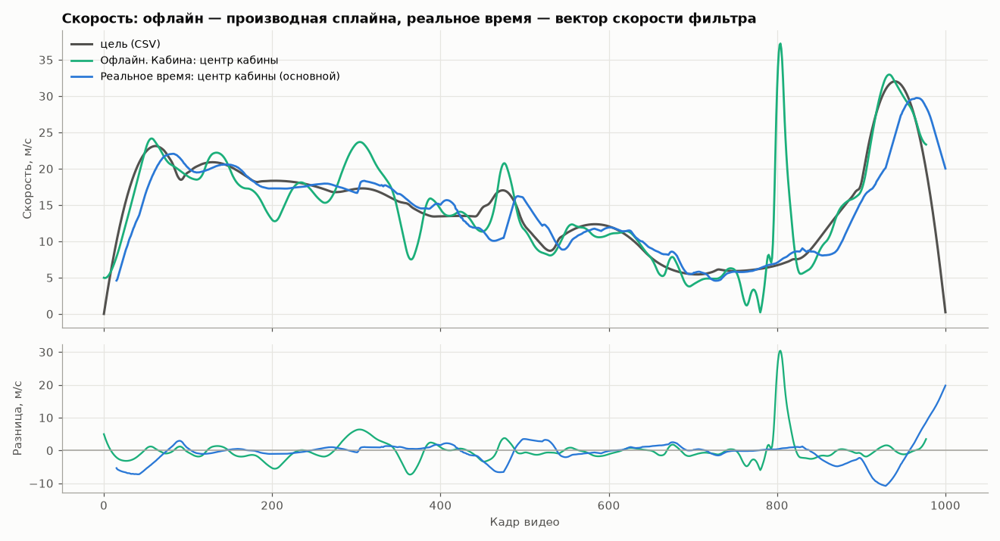
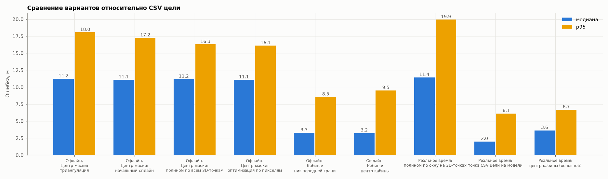
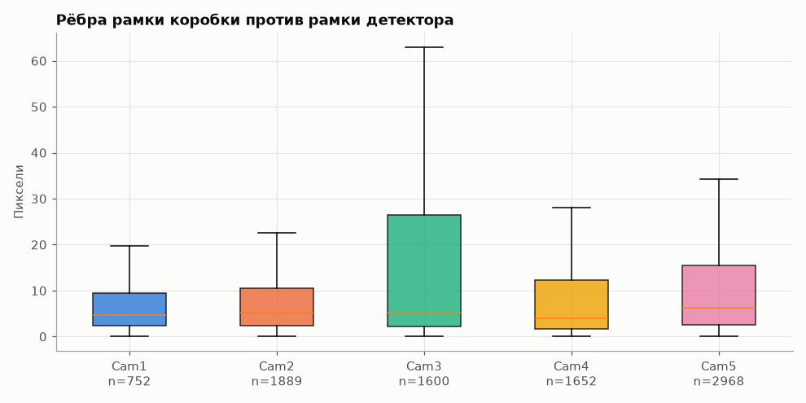
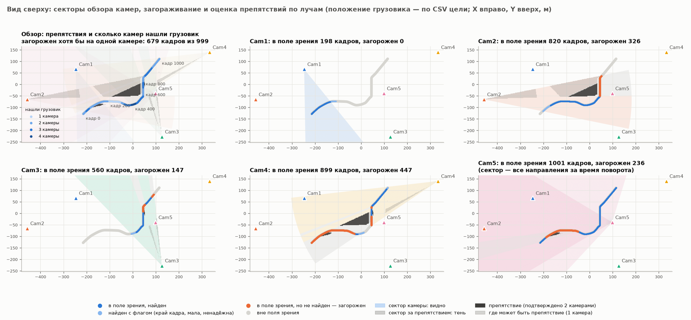
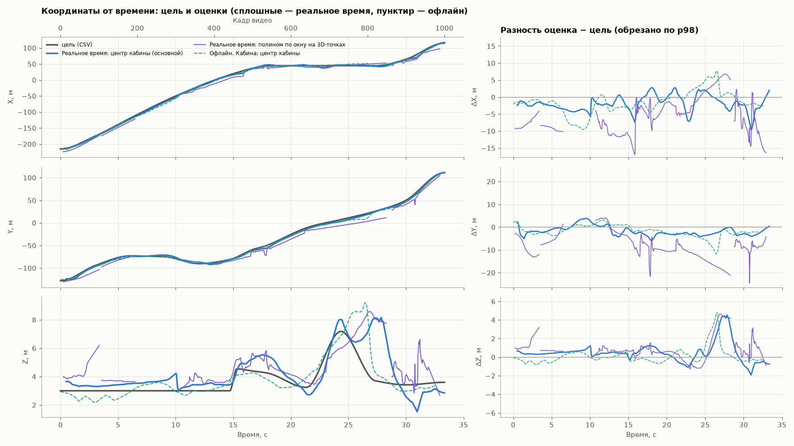
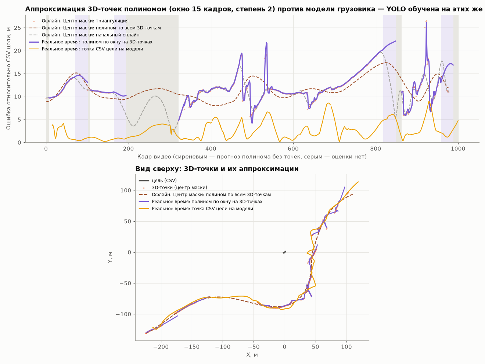
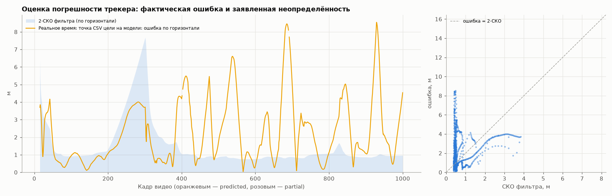

# Траектория грузовика: точка кабины

> ⚠️ Детектор YOLO дообучен на этих же видео: качество детекции оценено на обучающих данных.

> Основной результат считается **в реальном времени**: оценка на кадре t использует только кадры ≤ t. Варианты с пометкой «Офлайн» обрабатывают весь видеоряд сразу (заглядывают вперёд) и приведены только для сравнения.

Основной результат — **Реальное время: центр кабины (основной)**. Веса: `models\best.pt`, смещение кадров: 0.

Испорченные ячейки CSV цели (исключены из оценки): кадр 402, Loc_X = 'авг.13'; кадр 691, Loc_Y = 'июл.25'

Габариты коробки: 19.71 × 6.24 × 5.98 м (подобраны по рамкам; это «эффективная» коробка для рамок детектора, а не реальный размер грузовика). Оптимизация: сошлась, итераций 1212.

Центр кабины — точка на 1.20 м назад от передней грани и на 2.00 м выше её низа (допущение о типичной кабине, задаётся `--cab-center-back`/`--cab-center-up`). Точка CSV цели — опорная точка модели в Unreal, она ниже и впереди центра кабины, поэтому ошибка центра кабины относительно CSV включает это постоянное смещение. Строка «низ передней грани» показывает точность той же подгонки в точке, ближайшей к CSV.

## Сравнение с CSV цели, м (медиана / p95 / RMSE / максимум)

| Вариант | кадров | ошибка положения | без постоянного смещения | смещение вдоль / поперёк / верт., м | макс. скорость, м/с | ошибка скорости, медиана / p95, м/с | скачок скорости между кадрами, p99 / макс, м/с² | путь, м (цель) |
|---|---|---|---|---|---|---|---|---|
| Офлайн. Центр маски: триангуляция | 720 | 11.23 / 18.04 / 11.94 / 26.52 | 3.63 / 8.68 / 4.65 / 17.05 | -10.96 / +0.67 / +0.67 | — | — | — | — |
| Офлайн. Центр маски: начальный сплайн | 976 | 11.08 / 17.24 / 11.44 / 19.68 | 4.36 / 14.51 / 6.76 / 17.45 | -9.15 / +0.24 / +1.26 | 47.4 | 2.25 / 14.97 | 140.2 / 191.8 | 502 (475) |
| Офлайн. Центр маски: полином по всем 3D-точкам | 976 | 11.16 / 16.27 / 11.84 / 17.39 | 3.13 / 8.99 / 4.35 / 11.77 | -10.99 / -0.44 / +0.66 | 41.6 | 1.08 / 4.68 | 13.4 / 17.1 | 467 (475) |
| Офлайн. Центр маски: оптимизация по пикселям | 976 | 11.08 / 16.09 / 11.43 / 18.95 | 3.43 / 6.66 / 3.88 / 9.71 | -10.73 / +0.38 / +0.54 | 39.5 | 1.04 / 7.16 | 37.1 / 59.8 | 478 (475) |
| Офлайн. Кабина: низ передней грани | 976 | 3.28 / 8.54 / 4.65 / 13.78 | 2.33 / 6.69 / 3.58 / 12.24 | -2.26 / -0.57 / -1.85 | 35.9 | 1.25 / 5.87 | 64.4 / 136.9 | 471 (475) |
| Офлайн. Кабина: центр кабины | 976 | 3.24 / 9.49 / 4.86 / 14.73 | 2.36 / 6.11 / 3.41 / 11.88 | -3.44 / -0.45 / +0.11 | 37.2 | 1.20 / 5.74 | 66.2 / 154.9 | 473 (475) |
| Реальное время: полином по окну на 3D-точках | 834 | 11.40 / 19.91 / 12.82 / 26.17 | 4.12 / 10.22 / 5.72 / 17.79 | -11.43 / -0.11 / +0.88 | 136.8 | 1.86 / 24.57 | 1395.0 / 2948.4 | 601 (479) |
| Реальное время: точка CSV цели на модели | 984 | 1.99 / 6.12 / 3.13 / 8.96 | 1.84 / 6.05 / 3.08 / 8.49 | -0.53 / +0.11 / -0.08 | 29.8 | 1.04 / 8.23 | 12.1 / 12.2 | 525 (480) |
| **Реальное время: центр кабины (основной)** | 984 | 3.63 / 6.67 / 4.16 / 10.66 | 1.72 / 4.92 / 2.69 / 8.11 | -3.13 / +0.17 / +0.49 | 29.8 | 1.04 / 8.23 | 12.1 / 12.2 | 514 (480) |

Скорость цели по CSV: максимум 32.0 м/с; скачок скорости между кадрами p99 26.3 м/с².

## Ошибка по осям мира, м (смещение / MAE / RMSE)

| Вариант | доля кадров с оценкой | X | Y | Z | MAE 3D |
|---|---|---|---|---|---|
| Офлайн. Центр маски: триангуляция | 72 % | -5.56 / 6.27 / 7.23 | -7.83 / 8.41 / 9.42 | +0.67 / 0.90 / 1.17 | 11.54 |
| Офлайн. Центр маски: начальный сплайн | 98 % | -4.36 / 6.32 / 7.15 | -6.69 / 7.54 / 8.69 | +1.26 / 1.43 / 2.07 | 10.96 |
| Офлайн. Центр маски: полином по всем 3D-точкам | 98 % | -6.17 / 6.59 / 7.57 | -7.23 / 7.65 / 9.03 | +0.66 / 0.90 / 1.20 | 11.62 |
| Офлайн. Центр маски: оптимизация по пикселям | 98 % | -6.19 / 6.78 / 7.37 | -6.80 / 7.59 / 8.65 | +0.54 / 0.82 / 1.12 | 11.16 |
| Офлайн. Кабина: низ передней грани | 98 % | -0.72 / 2.31 / 3.29 | -1.10 / 1.83 / 2.55 | -1.85 / 2.01 / 2.07 | 4.08 |
| Офлайн. Кабина: центр кабины | 98 % | -1.55 / 2.76 / 3.64 | -1.78 / 2.46 / 3.10 | +0.11 / 0.52 / 0.89 | 4.19 |
| Реальное время: полином по окну на 3D-точках | 84 % | -5.55 / 6.75 / 7.73 | -8.45 / 8.92 / 10.11 | +0.88 / 1.09 / 1.51 | 12.34 |
| Реальное время: точка CSV цели на модели | 99 % | -0.29 / 1.71 / 2.40 | -0.28 / 1.21 / 1.66 | -0.08 / 0.71 / 1.13 | 2.52 |
| **Реальное время: центр кабины (основной)** | 99 % | -1.89 / 2.44 / 2.97 | -1.77 / 2.35 / 2.67 | +0.49 / 0.79 / 1.17 | 3.89 |

## Оценка погрешности реального времени

Фильтр заявляет СКО положения по горизонтали: медиана 0.48 м; фактическая ошибка по горизонтали (Реальное время: точка CSV цели на модели): медиана 1.68 м. Отношение ошибка / СКО: медиана 2.5; в пределах 2·СКО 43 % кадров (при честной ковариации ~95 %). Отношение больше ~2 означает, что ковариация занижена: ошибка курса и несовпадение модели с рамками в ней не учтены (см. compare/09_realtime_uncertainty.png).

Ошибка основного варианта по статусу кадра, м (медиана / p95 / RMSE / максимум):

| статус | кадров | ошибка |
|---|---|---|
| measured | 984 | 3.63 / 6.67 / 4.16 / 10.66 |

## Базовый вариант: обычная аппроксимация 3D-точек

Полином степени 2 по окну 15 кадров (только прошлое, Хьюбер 1.0 м) на точках триангуляции центров масок; без точек — прогноз последним полиномом по прямой до 30 кадров; 0.25 мс/кадр. Офлайн — один полином степени 8 по всем точкам. Оба наследуют смещение центра маски относительно точки CSV (столбец «без постоянного смещения» показывает ошибку формы) и скачки при смене камер; у них нет формы грузовика и курса, поэтому точку кабины из них получить нельзя. См. compare/08_approximation_vs_tracker.png.

## Реальное время: статусы кадров

Время на кадр: 2.4 мс (вместе с чтением поз камер).

| статус | кадров | что значит |
|---|---|---|
| initializing | 15 | ещё нет оценки (нужно несколько кадров с ≥2 камерами) |
| measured | 986 | хотя бы одна камера дала ≥3 ребра рамки |
| partial | 0 | детекции есть, но рёбра закрыты препятствием или краем кадра |
| predicted | 0 | детекций нет, прогноз по вектору движения |

Рёбер рамок, признанных закрытыми препятствием: 1004. Максимум кадров подряд без измерения: 0.

## Основной результат по числу камер с детекцией на кадре, м

| камер | кадров | медиана | p95 | максимум |
|---|---|---|---|---|
| 1 | 118 | 4.87 | 6.00 | 6.36 |
| 2 | 473 | 3.23 | 5.75 | 10.00 |
| 3 | 351 | 3.72 | 7.76 | 10.66 |
| 4 | 42 | 3.97 | 4.31 | 4.33 |

Кадры без единой детекции (≥3 подряд): нет

## Графики

Отчёт базового варианта (центр маски): [center/report.md](center/report.md); сводная таблица: [metrics_summary.csv](metrics_summary.csv)

## Известные ограничения реального времени

- Курс берётся из направления скорости фильтра. В медленном резком повороте (кадры ~650–850, ~5–6 м/с) он ошибается на десятки градусов, и точка кабины уходит вбок примерно на половину длины.
- Участок, где грузовик видит одна камера (кадры ~200–300), даёт большую ошибку по глубине.
- С 3D-моделью: масштаб актора ×3.186 подтверждается и без CSV цели (лучшее совпадение с рамками YOLO при ×3.0–3.19), а положение точки CSV на модели (передний край кабины, 3 м над дорогой) откалибровано по CSV цели — сверьте с актором в Unreal.
- Без 3D-модели — коробка 16.5 × 2.55 × 4.0 м (онлайн-уточнение габаритов расходится).
- Пределы ускорения и СКО ребра рамки подобраны под эту сцену (по CSV цели).
