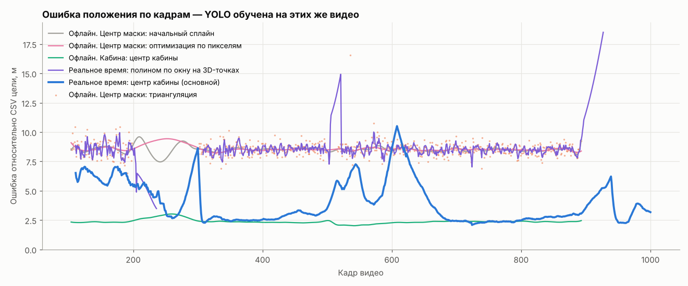
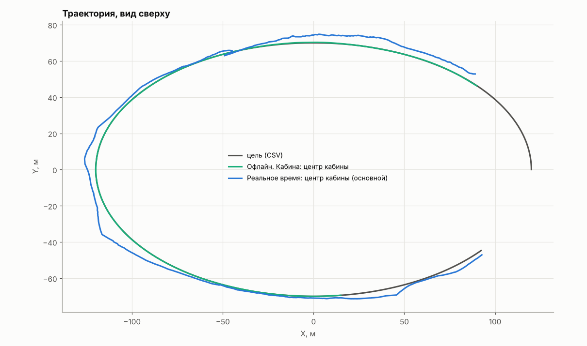
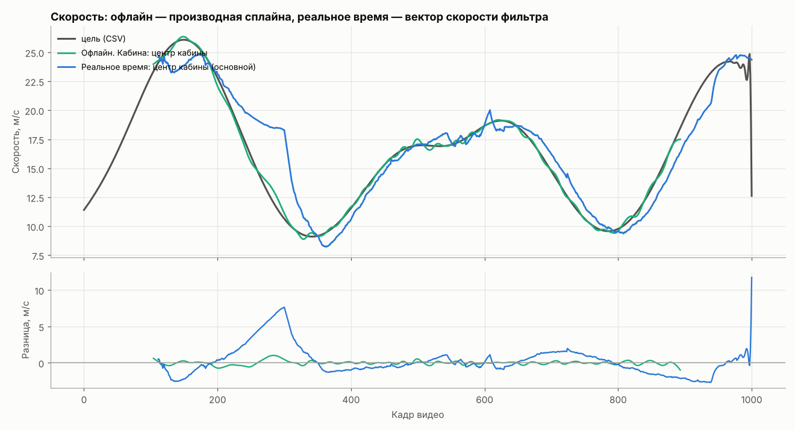
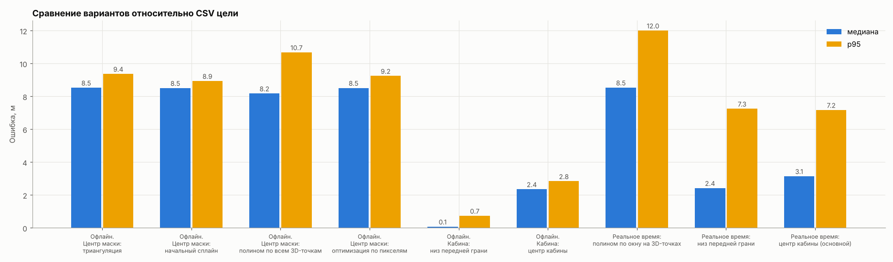
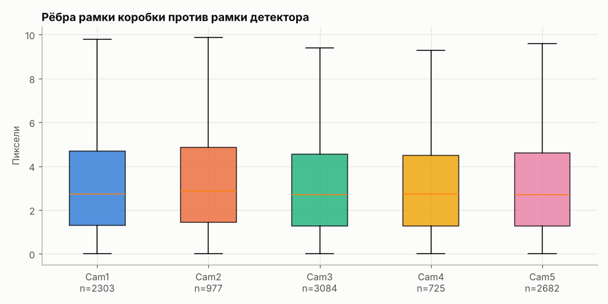
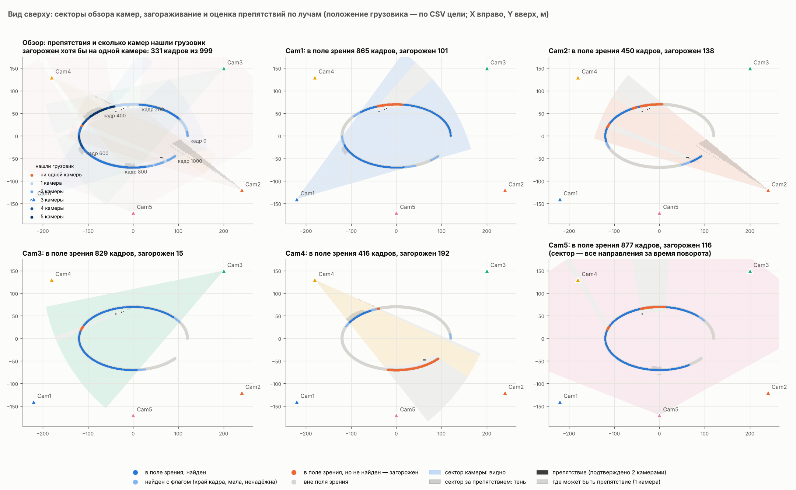
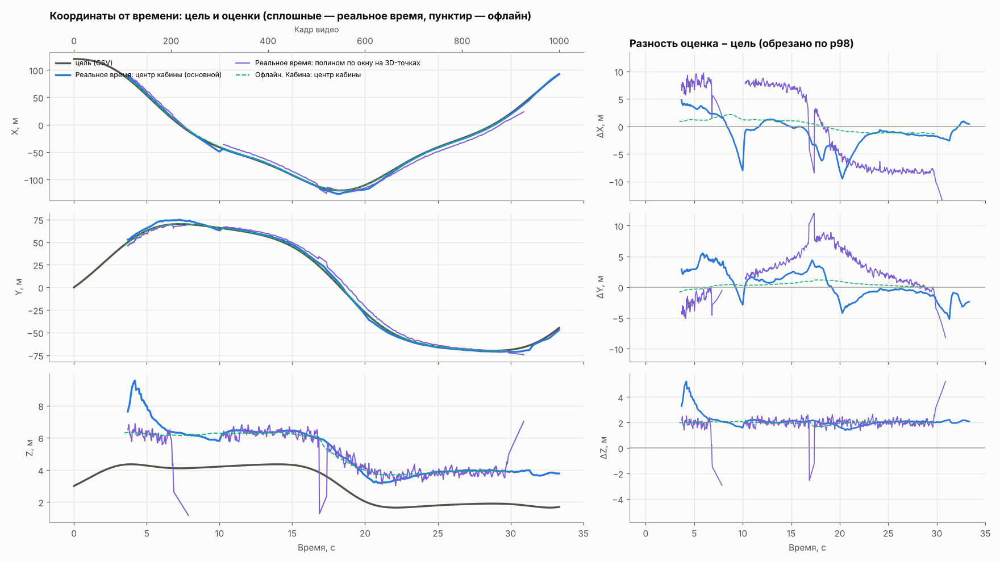
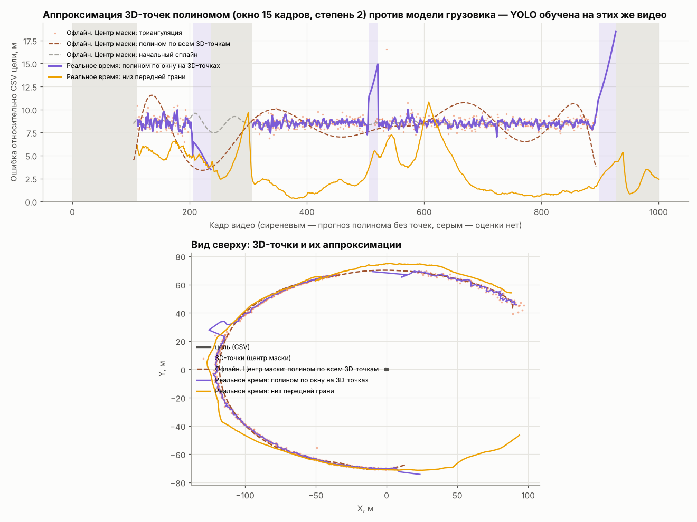
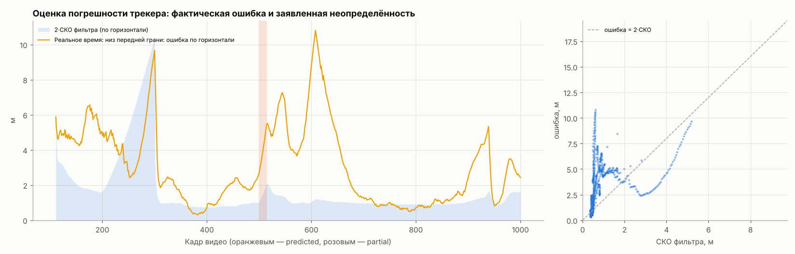

# Траектория грузовика: точка кабины

> ⚠️ Детектор YOLO дообучен на этих же видео: качество детекции оценено на обучающих данных.

> Основной результат считается **в реальном времени**: оценка на кадре t использует только кадры ≤ t. Варианты с пометкой «Офлайн» обрабатывают весь видеоряд сразу (заглядывают вперёд) и приведены только для сравнения.

Основной результат — **Реальное время: центр кабины (основной)**. Веса: `models/best.pt`, смещение кадров: 0.

Испорченные ячейки CSV цели (исключены из оценки): кадр 402, Loc_X = 'авг.13'; кадр 691, Loc_Y = 'июл.25'

Габариты коробки: 16.49 × 2.55 × 3.97 м (подобраны по рамкам; это «эффективная» коробка для рамок детектора, а не реальный размер грузовика). Оптимизация: сошлась, итераций 196.

Центр кабины — точка на 1.20 м назад от передней грани и на 2.00 м выше её низа (допущение о типичной кабине, задаётся `--cab-center-back`/`--cab-center-up`). Точка CSV цели — опорная точка модели в Unreal, она ниже и впереди центра кабины, поэтому ошибка центра кабины относительно CSV включает это постоянное смещение. Строка «низ передней грани» показывает точность той же подгонки в точке, ближайшей к CSV.

## Сравнение с CSV цели, м (медиана / p95 / RMSE / максимум)

| Вариант | кадров | ошибка положения | без постоянного смещения | смещение вдоль / поперёк / верт., м | макс. скорость, м/с | ошибка скорости, медиана / p95, м/с | скачок скорости между кадрами, p99 / макс, м/с² | путь, м (цель) |
|---|---|---|---|---|---|---|---|---|
| Офлайн. Центр маски: триангуляция | 669 | 8.53 / 9.37 / 8.57 / 16.56 | 0.66 / 1.90 / 1.12 / 11.10 | -8.26 / +0.05 / +1.99 | — | — | — | — |
| Офлайн. Центр маски: начальный сплайн | 788 | 8.51 / 8.94 / 8.52 / 9.60 | 0.33 / 2.71 / 1.06 / 4.62 | -8.21 / -0.24 / +2.00 | 27.3 | 0.33 / 2.34 | 20.1 / 42.1 | 417 (413) |
| Офлайн. Центр маски: полином по всем 3D-точкам | 788 | 8.18 / 10.68 / 8.28 / 11.55 | 1.77 / 4.41 / 2.27 / 6.56 | -7.72 / +0.15 / +1.96 | 35.2 | 1.28 / 5.41 | 21.5 / 26.4 | 415 (413) |
| Офлайн. Центр маски: оптимизация по пикселям | 788 | 8.52 / 9.25 / 8.59 / 9.44 | 0.17 / 0.76 / 0.30 / 1.18 | -8.35 / +0.01 / +1.99 | 26.0 | 0.21 / 0.72 | 5.2 / 5.6 | 416 (413) |
| Офлайн. Кабина: низ передней грани | 788 | 0.08 / 0.74 / 0.28 / 1.02 | 0.12 / 0.65 / 0.26 / 0.93 | -0.09 / -0.02 / -0.01 | 26.4 | 0.11 / 0.65 | 5.1 / 5.4 | 413 (413) |
| Офлайн. Кабина: центр кабины | 788 | 2.35 / 2.84 / 2.38 / 3.02 | 0.11 / 0.67 / 0.26 / 0.95 | -1.28 / -0.02 / +1.99 | 26.4 | 0.13 / 0.63 | 5.0 / 5.8 | 413 (413) |
| Реальное время: полином по окну на 3D-точках | 744 | 8.54 / 12.01 / 8.87 / 18.51 | 0.61 / 7.03 / 2.65 / 12.49 | -8.27 / -0.28 / +1.82 | 78.0 | 2.56 / 7.83 | 479.8 / 1379.7 | 569 (431) |
| Реальное время: низ передней грани | 888 | 2.43 / 7.25 / 3.90 / 10.82 | 1.91 / 5.81 / 2.80 / 10.48 | -0.13 / -2.71 / +0.14 | 24.9 | 0.90 / 4.88 | 12.0 / 12.1 | 526 (488) |
| **Реальное время: центр кабины (основной)** | 888 | 3.15 / 7.17 / 4.39 / 10.51 | 1.79 / 5.49 / 2.65 / 10.36 | -1.29 / -2.46 / +2.14 | 24.9 | 0.90 / 4.88 | 12.0 / 12.1 | 524 (488) |

Скорость цели по CSV: максимум 26.1 м/с; скачок скорости между кадрами p99 5.1 м/с².

## Ошибка по осям мира, м (смещение / MAE / RMSE)

| Вариант | доля кадров с оценкой | X | Y | Z | MAE 3D |
|---|---|---|---|---|---|
| Офлайн. Центр маски: триангуляция | 67 % | -0.13 / 6.91 / 7.20 | +2.69 / 3.42 / 4.19 | +1.99 / 1.99 / 2.01 | 8.55 |
| Офлайн. Центр маски: начальный сплайн | 79 % | +0.89 / 6.94 / 7.19 | +2.75 / 3.35 / 4.08 | +2.00 / 2.00 / 2.05 | 8.51 |
| Офлайн. Центр маски: полином по всем 3D-точкам | 79 % | +0.55 / 6.50 / 7.03 | +2.46 / 3.11 / 3.92 | +1.96 / 1.96 / 1.97 | 8.06 |
| Офлайн. Центр маски: оптимизация по пикселям | 79 % | +1.06 / 7.12 / 7.38 | +2.53 / 3.13 / 3.92 | +1.99 / 1.99 / 1.99 | 8.59 |
| Офлайн. Кабина: низ передней грани | 79 % | +0.08 / 0.11 / 0.24 | +0.03 / 0.05 / 0.09 | -0.01 / 0.07 / 0.11 | 0.17 |
| Офлайн. Кабина: центр кабины | 79 % | +0.22 / 1.10 / 1.17 | +0.39 / 0.47 / 0.57 | +1.99 / 1.99 / 2.00 | 2.38 |
| Реальное время: полином по окну на 3D-точках | 75 % | -0.79 / 7.02 / 7.41 | +2.33 / 3.55 / 4.39 | +1.82 / 2.09 / 2.15 | 8.71 |
| Реальное время: низ передней грани | 89 % | -1.18 / 1.96 / 2.89 | +0.15 / 2.10 / 2.55 | +0.14 / 0.28 / 0.62 | 3.15 |
| **Реальное время: центр кабины (основной)** | 89 % | -1.11 / 2.23 / 2.96 | +0.40 / 1.97 / 2.38 | +2.14 / 2.14 / 2.21 | 4.01 |

## Оценка погрешности реального времени

Фильтр заявляет СКО положения по горизонтали: медиана 0.50 м; фактическая ошибка по горизонтали (Реальное время: низ передней грани): медиана 2.42 м. Отношение ошибка / СКО: медиана 3.6; в пределах 2·СКО 24 % кадров (при честной ковариации ~95 %). Отношение больше ~2 означает, что ковариация занижена: ошибка курса и несовпадение модели с рамками в ней не учтены (см. compare/09_realtime_uncertainty.png).

Ошибка основного варианта по статусу кадра, м (медиана / p95 / RMSE / максимум):

| статус | кадров | ошибка |
|---|---|---|
| measured | 873 | 3.11 / 7.19 / 4.39 / 10.51 |
| predicted | 15 | 4.47 / 5.63 / 4.59 / 5.78 |

## Базовый вариант: обычная аппроксимация 3D-точек

Полином степени 2 по окну 15 кадров (только прошлое, Хьюбер 1.0 м) на точках триангуляции центров масок; без точек — прогноз последним полиномом по прямой до 30 кадров; 0.34 мс/кадр. Офлайн — один полином степени 8 по всем точкам. Оба наследуют смещение центра маски относительно точки CSV (столбец «без постоянного смещения» показывает ошибку формы) и скачки при смене камер; у них нет формы грузовика и курса, поэтому точку кабины из них получить нельзя. См. compare/08_approximation_vs_tracker.png.

## Реальное время: статусы кадров

Время на кадр: 1.8 мс (вместе с чтением поз камер).

| статус | кадров | что значит |
|---|---|---|
| initializing | 111 | ещё нет оценки (нужно несколько кадров с ≥2 камерами) |
| measured | 875 | хотя бы одна камера дала ≥3 ребра рамки |
| partial | 0 | детекции есть, но рёбра закрыты препятствием или краем кадра |
| predicted | 15 | детекций нет, прогноз по вектору движения |

Рёбер рамок, признанных закрытыми препятствием: 487. Максимум кадров подряд без измерения: 15.

## Основной результат по числу камер с детекцией на кадре, м

| камер | кадров | медиана | p95 | максимум |
|---|---|---|---|---|
| 1 | 120 | 4.65 | 7.47 | 8.64 |
| 2 | 72 | 3.66 | 5.25 | 5.70 |
| 3 | 435 | 3.05 | 8.22 | 10.51 |
| 4 | 122 | 3.16 | 6.29 | 7.70 |
| 5 | 124 | 2.55 | 3.29 | 7.44 |

Кадры без единой детекции (≥3 подряд): 500–514

## Графики

Отчёт базового варианта (центр маски): [center/report.md](center/report.md); сводная таблица: [metrics_summary.csv](metrics_summary.csv)

## Известные ограничения реального времени

- Курс берётся из направления скорости фильтра. В медленном резком повороте (кадры ~650–850, ~5–6 м/с) он ошибается на десятки градусов, и точка кабины уходит вбок примерно на половину длины.
- Участок, где грузовик видит одна камера (кадры ~200–300), даёт большую ошибку по глубине.
- С 3D-моделью: масштаб актора ×3.186 подтверждается и без CSV цели (лучшее совпадение с рамками YOLO при ×3.0–3.19), а положение точки CSV на модели (передний край кабины, 3 м над дорогой) откалибровано по CSV цели — сверьте с актором в Unreal.
- Без 3D-модели — коробка 16.5 × 2.55 × 4.0 м (онлайн-уточнение габаритов расходится).
- Пределы ускорения и СКО ребра рамки подобраны под эту сцену (по CSV цели).
